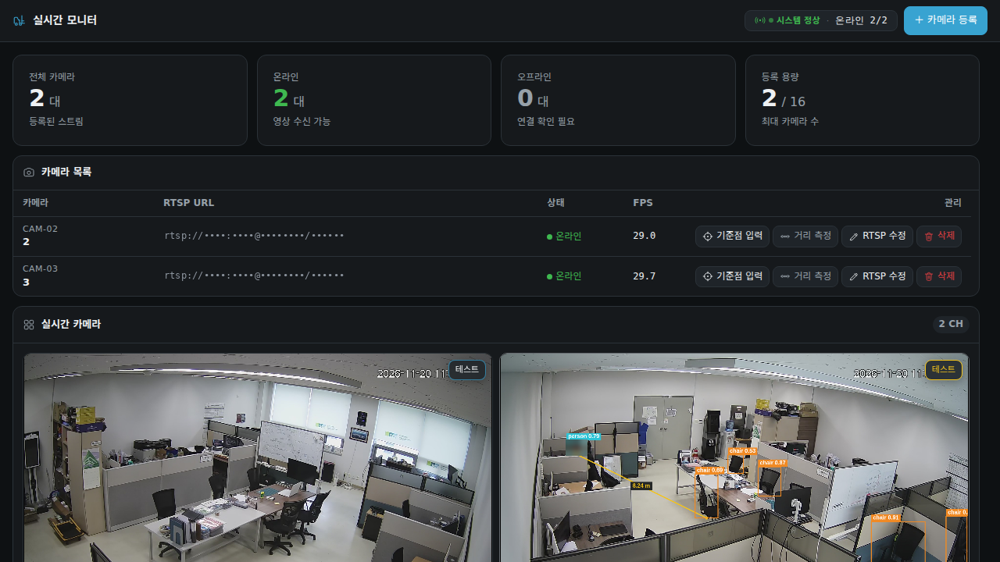

# forklift-distance



# 설치 · 실행 (setup 스크립트)

```bash
git clone https://github.com/jskim1102/forklift-distance forklift-distance
cd forklift-distance
```

| 운영체제 | 실행 |
|---|---|
| Linux · macOS | `./setup.sh` |
| Windows | `setup.cmd` 더블클릭 |

접속 : `http://localhost:<FRONTEND_PORT>`

* 지게차와 사람 사이 거리를 안전 목적으로 측정하는 실시간 카메라 대시보드.
* RTSP 카메라를 등록·수정·삭제하고, 영상은 MediaMTX 가 브라우저에 WebRTC(WHEP)로 실시간 전달.
* 카메라마다 기준점 입력 — 화면의 바닥 위 점 4~12개와 점 사이 실제 거리(m)로 화면 좌표를 실제 좌표로 바꾸는 값 저장.
* 수동 거리 측정 — 영상 위 두 점을 클릭하면 두 점 사이 실제 거리(m) 표시.
* 자동 거리 측정 — 검출 모델이 두 개: **기준** 레인(사람)과 **상대** 레인(지게차).
* 기준 클래스의 객체마다 가장 가까운 상대 클래스 객체까지 선과 거리(m) 표시.
* 거리는 박스 아래쪽 가운데(바닥에 닿는 점) 기준.
* 레인마다 직접 학습한 `.pt` 업로드로 모델 교체 (예: 상대 레인에 지게차 모델).
* 업로드가 없는 레인은 공식 YOLO 모델(`YOLO_DEFAULT_MODEL`, 기본 `yolo26x`) 사용.
* 모델을 바꾸면 맞지 않게 된 클래스 선택을 다시 확인.
* 영상 경로와 추론 경로 분리 — 추론이 느려져도 영상은 끊김 없음.
* 카메라 수와 GPU 부하에 맞춰 추론 해상도 · 속도 자동 조절.
* `docker compose` 한 번으로 **backend + frontend + MediaMTX 세 컨테이너** 동시 실행.
* NVIDIA GPU 가 있으면 GPU, 없으면 CPU 로 추론.

# 환경변수 (`.env`)

* setup 이 `.env.example` 을 복사해 `.env` 생성, 포트·비밀번호 자동 입력.
* 값을 바꿀 때만 직접 수정 후 setup 다시 실행 (frontend 가 포트·비밀번호를 빌드 때 넣으므로 다시 빌드 필요).
* 비밀번호가 들어가므로 이 파일은 공유 금지.

| 변수 | 값 | 설명 |
|---|---|---|
| `FRONTEND_PORT` | 자동 | 웹페이지 포트 (브라우저 접속 주소) |
| `BACKEND_PORT` | 자동 | 백엔드 API 포트 (브라우저가 직접 접속) |
| `MEDIAMTX_WEBRTC_PORT` | 자동 | MediaMTX 영상 연결 포트 |
| `MEDIAMTX_ICE_UDP_PORT` | 자동 | MediaMTX 영상 데이터 포트 |
| `MEDIAMTX_RTSP_PORT` | 자동 | MediaMTX RTSP 재송출 포트 |
| `MEDIAMTX_API_PORT` | 자동 | MediaMTX 제어 포트 |
| `MEDIAMTX_BACKEND_PASS` | 자동&nbsp;(무작위) | MediaMTX 제어용 비밀번호 |
| `MEDIAMTX_VIEWER_PASS` | 자동&nbsp;(무작위) | 영상 시청용 비밀번호 |
| `MEDIAMTX_WEBRTC_HOST` | setup&nbsp;이&nbsp;질문 | 브라우저가 이 PC 에 닿는 주소 전부 (쉼표 구분) |
| `YOLO_DEFAULT_MODEL` | `yolo26x.pt` | 업로드 없는 레인의 기본 검출 모델 |
| `YOLO_CONF_THRESHOLD` | `0.5` | 객체로 볼 최소 신뢰도 기본값 |
| `YOLO_DEVICE` | 빈칸 | 추론 장치 (빈칸 = 자동) |
| `WEIGHTS_DIR` | 빈칸 | 업로드한 모델 저장 폴더 (빈칸 = 기본 위치) |
| `MAX_IPCAMS` | 선택&nbsp;(직접&nbsp;추가) | 등록 가능 카메라 수 (기본 16) |

* MediaMTX 포트 4개는 아래 "포트 · 방화벽" 참고.
* 나머지 값(`MEDIAMTX_API`, `MEDIAMTX_VIEWER_USER`)은 기본값 그대로 유지.
* Docker 에서 쓸 수 있는 NVIDIA GPU 가 있으면 setup 이 `.env` 에 `COMPOSE_FILE` 을 넣어 GPU 설정(`docker-compose.gpu.yml`) 적용.
* GPU 가 없으면 `COMPOSE_FILE` 없이 CPU 로 실행.
* `MEDIAMTX_WEBRTC_HOST`
  * 예: `192.168.0.20,100.64.0.10,203.0.113.5` (LAN · VPN · 공인 IP).
  * setup 질문에 여러 주소를 쉼표로 넣거나, 나중에 `.env` 에 직접 추가 (아래 "외부망 · VPN 접속" 참고).
  * **비우면 이 PC에서만 영상 표시.**
  * **목록에 없는 주소로 접속하면 화면은 열려도 영상은 검은 화면.**
  * LAN IP 찾는 법: `hostname -I` (Linux) · `ipconfig getifaddr en0` (macOS) · `ipconfig` (Windows).
* `YOLO_DEFAULT_MODEL`
  * `yolo26n.pt` · `yolo26s.pt` · `yolo26m.pt` · `yolo26l.pt` · `yolo26x.pt` 중 하나.
  * 뒤로 갈수록 정확하지만 무거움 — GPU 메모리가 작으면 `yolo26n.pt` 쪽.
  * 비우거나 목록에 없는 이름이면 `yolo26x.pt` 사용.
  * 레인에 `.pt` 를 업로드하면 그 레인은 업로드한 모델 우선, 업로드를 지우면 이 값으로 복귀.
  * 바꾸면 화면에서 측정 클래스를 다시 선택.
* `YOLO_DEVICE`
  * 빈칸이면 GPU 가 있을 때 GPU, 없으면 CPU.
  * 예: `cpu`, `cuda:0` (첫 번째 GPU).
* `WEIGHTS_DIR`
  * 빈칸이면 Docker 는 볼륨 안 `/app/data/weights` 에 저장 — 컨테이너를 다시 만들어도 유지.
* 공식 YOLO 모델 파일은 처음 쓸 때 자동 다운로드 (`weights.txt` 참고).
* Docker 에서는 받은 모델을 볼륨에 보관 — 컨테이너를 다시 만들어도 재다운로드 없음.

> **비밀번호를 직접 바꿀 때 문자 제한**
> * MediaMTX가 비밀번호에 `%`, `?`, `/`, `:`, `,`, 공백, 따옴표 등 사용 불가.
> * 영문·숫자와 `!@#-_.` 정도로만 지정.
> * 허용 안 되는 문자를 쓰면 MediaMTX 컨테이너 재시작 반복.

# 포트 · 방화벽

* 실제 포트 번호는 `.env` 에 기록 (`grep _PORT .env` 로 확인).

| 서비스 | `.env` 변수 | 용도 | 개방 |
|---|---|---|---|
| Frontend | `FRONTEND_PORT` (tcp) | 웹페이지 | 필요 |
| Backend | `BACKEND_PORT` (tcp) | API · 검출 결과 | 필요 |
| MediaMTX&nbsp;WebRTC | `MEDIAMTX_WEBRTC_PORT` (tcp) | 영상&nbsp;연결&nbsp;시작 | 필요 |
| MediaMTX&nbsp;ICE | `MEDIAMTX_ICE_UDP_PORT` (udp·tcp) | **영상&nbsp;데이터** | 필요 |
| MediaMTX&nbsp;RTSP | `MEDIAMTX_RTSP_PORT` (tcp) | RTSP&nbsp;재송출 | 불필요 |
| MediaMTX&nbsp;API | `MEDIAMTX_API_PORT` (tcp) | backend&nbsp;제어용 | 불필요 |

* 개방 = 다른 기기에서 접속할 때 방화벽 개방 필요 여부.
* Backend 는 FastAPI, 브라우저가 이 API 와 검출 결과 WebSocket 에 직접 접속.
* ICE 포트는 필수 — 없으면 영상 안 나옴.
* ICE 의 같은 번호 tcp 는 UDP 가 막힌 망용 예비.
* RTSP 재송출은 브라우저 미사용.
* MediaMTX API 는 이 PC(127.0.0.1)에만 열림.
* 다른 기기에서 접속하려면 방화벽/공유기에서 위 "필요" 4개 개방.
* Linux(ufw) 예 — `< >` 자리에 `.env` 의 실제 번호:

```bash
sudo ufw allow <FRONTEND_PORT>/tcp           # frontend
sudo ufw allow <BACKEND_PORT>/tcp            # backend
sudo ufw allow <MEDIAMTX_WEBRTC_PORT>/tcp    # MediaMTX WebRTC (영상 연결)
sudo ufw allow <MEDIAMTX_ICE_UDP_PORT>/udp   # MediaMTX ICE (영상 데이터 — 필수)
sudo ufw allow <MEDIAMTX_ICE_UDP_PORT>/tcp   # MediaMTX ICE (UDP 막힌 망용 예비)
```

> * ICE udp 포트를 빠뜨리면 카메라 화면이 "연결됨"까지 갔다가 영상만 표시되지 않는, 원인 찾기 어려운 증상 발생.
> * 반드시 개방.

## 외부망 · VPN 접속

* 같은 LAN 밖(회사 밖, 휴대폰 데이터, VPN)에서 접속하는 경우.
* 포트 개방만으로는 부족 — 영상 주소 목록(`MEDIAMTX_WEBRTC_HOST`)에 그 경로의 IP 추가 필요.

1. **공인 IP 로 접속 (공유기 포트포워딩)**
   * 공유기에서 위 "필요" 4개 포워딩: `FRONTEND_PORT` · `BACKEND_PORT` · `MEDIAMTX_WEBRTC_PORT` (tcp), `MEDIAMTX_ICE_UDP_PORT` (udp + tcp).
   * **ICE 포트는 바깥 번호와 안쪽 번호를 같게** (예: 공인 `18003` → 이 PC `18003`).
   * MediaMTX 가 안쪽 번호를 그대로 알려 주므로 번호가 다르면 영상 연결 실패.
   * 공인 IP 를 `MEDIAMTX_WEBRTC_HOST` 에 추가.
2. **VPN 으로 접속 (tailscale 등)**
   * 이 PC 의 VPN IP (예: tailscale `tailscale ip -4`) 를 `MEDIAMTX_WEBRTC_HOST` 에 추가.
   * 포트포워딩 불필요.
3. `.env` 를 바꾼 뒤 setup 다시 실행.

* 예: LAN + tailscale + 공인 IP 모두 쓰는 경우 — `MEDIAMTX_WEBRTC_HOST=192.168.0.20,100.64.0.10,203.0.113.5`

# 주의

* **안전 보조 도구** — 측정 거리는 참고값, 실제 안전 판단과 설비를 대신하지 않음.
* **인증 없음**
  * `BACKEND_PORT`에 닿는 누구나 카메라 CRUD · 기준점 · 측정 설정 · 모델 업로드 가능.
  * rtsp 비밀번호는 응답에서 `***`로 마스킹.
  * 공개 배포 시 리버스 프록시/인증 뒤에 배치.
* 카메라 등록은 MediaMTX 등록이 성공해야 저장.
* MediaMTX가 준비되기 전 잠깐은 등록이 실패할 수 있으나 곧 정상화.
* 거리 측정은 기준점을 먼저 저장해야 사용 가능.
* 거리는 바닥 평면 기준 — 기준점도 바닥 위 점으로 입력.
* 공식 YOLO 모델에는 지게차 클래스가 없음 — 지게차 검출은 지게차를 학습한 `.pt` 를 상대 레인에 업로드해야 가능.
* GPU 없이 CPU 로 돌리면 추론 속도 크게 저하 — 카메라 수가 많으면 박스 · 거리 갱신이 느려짐.
